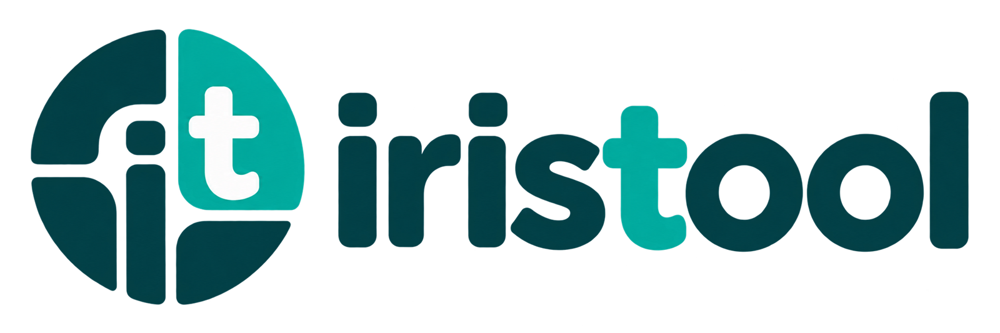

# iristool logo assets

The iristool identity combines a segmented iris with an `it` monogram. The white
`t` inside the turquoise segment echoes the turquoise `t` in the wordmark.

## Downloads

All production files are PNGs with transparent backgrounds. The white `t` inside
the symbol is opaque white so it remains readable on colored backgrounds.

| Variant | Presentation master | Smaller exports (width in pixels) |
| --- | --- | --- |
| Full logo: symbol + wordmark | [logo.png](logo.png), 2172 × 724 | [1600](logo-1600.png), [800](logo-800.png) |
| Symbol only | [symbol.png](symbol.png), 1254 × 1254 | [512](symbol-512.png), [256](symbol-256.png), [64](symbol-64.png), [32](symbol-32.png) |
| Wordmark only | [wordmark.png](wordmark.png), 2172 × 724 | [1600](wordmark-1600.png), [800](wordmark-800.png) |

The [approved concept](approved-concept.png) preserves the original white-background
design sheet for reference; use the separate transparent exports in layouts.

## Usage

- Use the full logo on title slides, README headers, and documentation covers.
- Use the symbol for avatars and compact placements; prefer at least 64 pixels
  when the internal monogram needs to be clearly readable. The 32-pixel version
  is available for small icons, where detail is reduced.
- Use the wordmark where the symbol already appears elsewhere in the layout.
- Keep the aspect ratio, leave clear space around the artwork, and place it on
  a white or light neutral background for good contrast with the petrol letters.
- Insert the native-size masters into presentations and scale down. These are
  raster assets; enlarging beyond their native resolution does not add detail.

The design palette is petrol (`#123D46`), turquoise (`#25B9AD`), and white
(`#FFFFFF`). These are the intended brand colors; generated raster files can
contain slight tonal variation and antialiasing.

The root README uses a repository-relative image path so the logo is visible on
GitHub in the current branch as well as after merging into `main`. For use outside
GitHub (including a PyPI release), use an absolute URL to the published asset.

## Asset preparation

The transparent masters were prepared with the built-in imagegen tool from the
approved concept. The generation brief was to extract each of the three variants
without redesigning the shapes, typography, proportions, or colors; preserve the
white internal `t`; remove the presentation background and duplicate icon; and
produce crisp transparent PNGs. Smaller files are proportional downscaled exports
of those masters, with alpha preserved and no upscaling.
